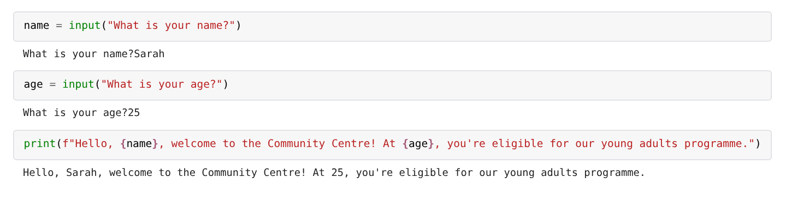
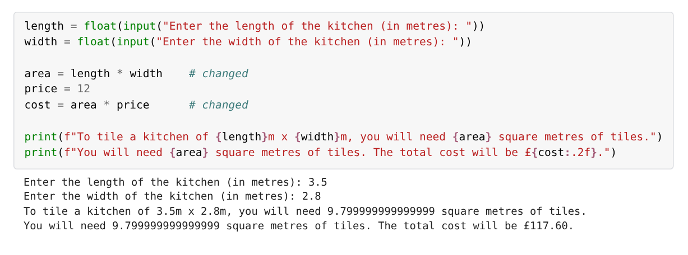
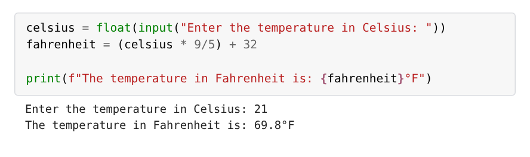
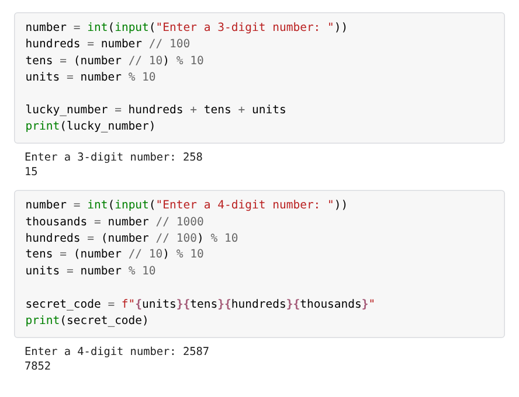
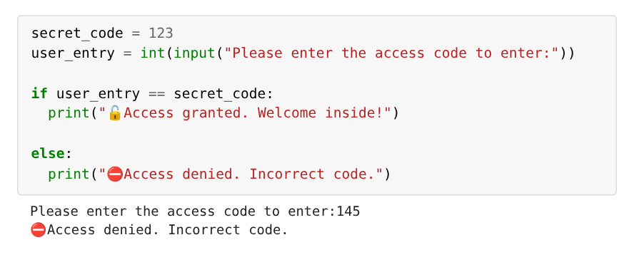
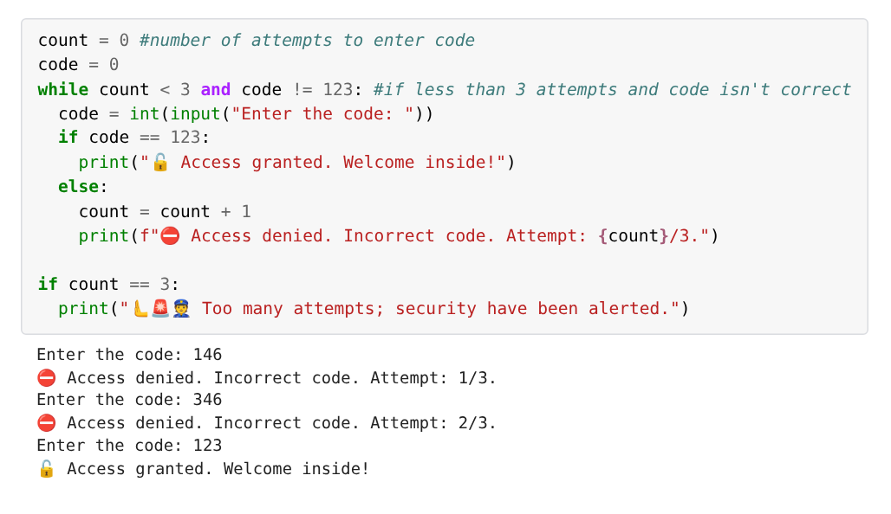
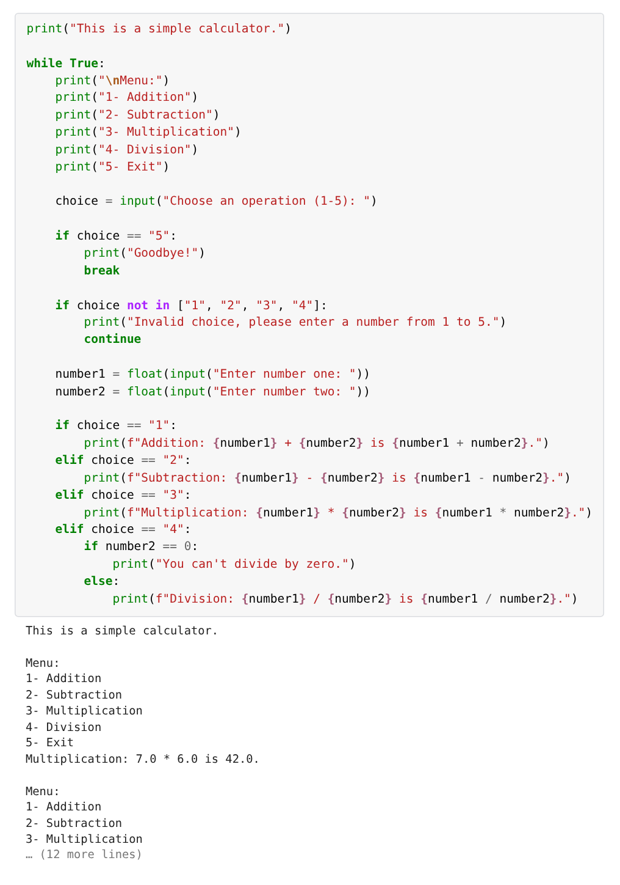
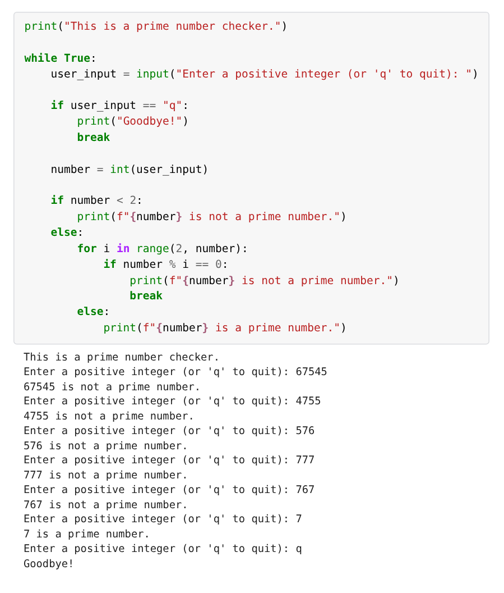
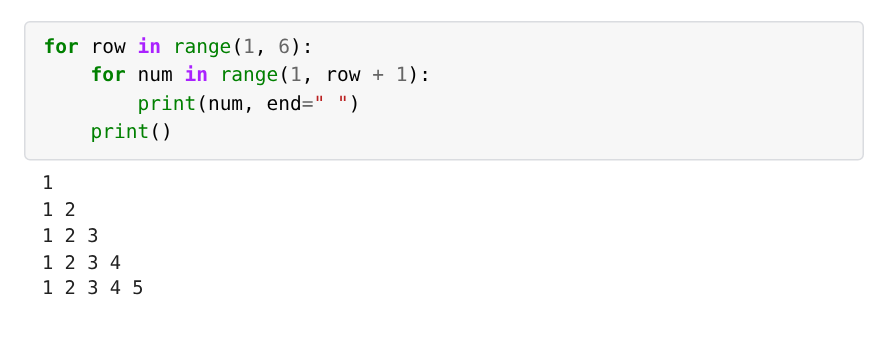
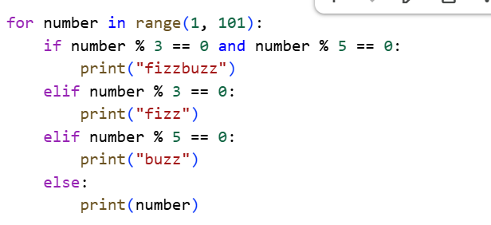

# 🐍 Python basics

Two Google Colab notebooks from Week 6 of my bootcamp, where I wrote small interactive programs in Python: converters, calculators, a security keypad, a prime checker and FizzBuzz. I used variables, `print()` and `input()`, type casting, `if` statements, and `for` and `while` loops to build the logic, do the calculations and respond to what a user types.

## 🔎 At a glance

| | |
|---|---|
| **Tools** | Python 3, Google Colab |
| **Notebooks** | Day 1: Python basics (6 programs). Day 2: conditions and loops (7 programs, plus FizzBuzz) |
| **Bootcamp week** | Week 6 (October 2026), Level 3 Data Technician Skills Bootcamp, Leep Talent |
| **Type** | Scenario exercises set by the course. I wrote all the programs. |
| **Colab links** | [Day 1 notebook](https://colab.research.google.com/drive/1p4Em54cQsqtZWO4XPGt_r9U_xCQ-17oj?usp=sharing) · [Day 2 notebook](https://colab.research.google.com/drive/1Z9JhK_a0CzQt0qisn4c7vVyw05hvEM1x?usp=sharing) |

## 🎯 Objective

Learn the building blocks of Python and use them to write programs that ask the user for information, make decisions, repeat steps and print clear results.

## 🛠️ Approach

| Notebook | What I built |
|---|---|
| [Day 1: Python basics](notebooks/day1-python-basics.ipynb) | A visitor greeting, a tile area and cost calculator, a temperature converter, a miles and kilometres converter, a digit-sum "lucky number" and a four-digit reverser |
| [Day 2: conditions and loops](notebooks/day2-conditions-and-loops.ipynb) | A keypad that locks after three wrong codes, a divisibility checker, a menu calculator, a sum of 1 to n, a prime checker, a factorial calculator, a number staircase and FizzBuzz |

Each scenario described a small real-world tool, such as a reception desk greeting or a theme park "lucky number", and I wrote the program to match.

## 🧩 Code highlights

Screenshots of code and output from my notebooks, each showing a different part of Python.

### Variables, `input()` and `print()`

`input()` asks a question and stores the answer in a variable, here `name` and `age`. An f-string then drops both variables into one `print()` message.

### Type casting and calculations

`input()` always returns text, so `float()` converts each answer to a number before the calculation. The area is stored in a variable so the cost can reuse it, and `:.2f` formats the cost as money: £117.60 for a 3.5m by 2.8m kitchen.

The same pattern with a formula: cast the input with `float()`, apply the conversion, and print the result. 21°C comes out as 69.8°F.

### Floor division and modulus

`//` divides and drops the remainder, while `%` keeps only the remainder. Together they split a number into its digits: 258 gives a lucky number of 2 + 5 + 8 = 15, and 2587 reverses to 7852.

### `if` and `else`

`int()` turns the typed code into a number so it can be compared with 123. The `if` branch handles a match and the `else` branch handles everything else.

### A `while` loop with a counter

The loop keeps asking while there are attempts left and the code is wrong. `count` goes up by 1 after each wrong code, and the final `if` raises the alert after three failures. In this run, the third attempt was correct.

### `while True`, `break` and `continue`

`while True` shows the menu again after every sum, until the user picks 5 and `break` ends the loop. An invalid choice triggers `continue`, which skips straight back to the menu. Before dividing, an `if` checks for zero so the program can't crash.

### A `for` loop with `break` and `else`

The `for` loop tries every number from 2 upwards as a divisor and stops with `break` at the first one that divides exactly. The `else` belongs to the `for` loop, so it only runs when no divisor was found, which means the number is prime. I tested it with six numbers: 7 is prime, and 767 isn't (it's 13 × 59).

### Nested `for` loops

The outer loop counts the rows and the inner loop prints the numbers on each row, so every line is one number longer than the one before.

### FizzBuzz

The task: print the numbers 1 to 100, replacing multiples of 3 with "fizz", multiples of 5 with "buzz" and multiples of both with "fizzbuzz". The order of the checks matters. Testing for "both" first means 15, 30, 45 and so on print "fizzbuzz". If the check for 3 came first, those numbers would print "fizz" and never reach the "fizzbuzz" branch. The output starts `1 2 fizz 4 buzz fizz 7 8 fizz buzz 11 fizz 13 14 fizzbuzz`.

## 💡 Skills used

**Technical**
- Variables holding text, whole numbers and decimals
- `print()` with f-strings, including formatting such as `:.2f`
- `input()` to read what the user types
- Type casting with `int()` and `float()`
- Arithmetic, including floor division (`//`) and modulus (`%`)
- `if`, `elif` and `else` with comparisons and `and`
- `for` loops with `range()`, nested `for` loops, and `for` with `else`
- `while` loops with a counter, and `while True` with `break` and `continue`

**Transferable**
- Turning a written scenario into step-by-step logic
- Handling wrong input: a limit on attempts, an invalid menu choice and a divide-by-zero check
- Testing a program with several inputs, not just one

## 🧠 What I'd change

- **Format numbers for people.** The tile area prints as 9.799999999999999 because of how computers store decimals. Formatting it with `:.2f`, as I did for the cost, would print 9.80.
- **Check input before converting it.** If someone types a word where a number is expected, `int()` stops the program with an error. Wrapping the conversion in `try` and `except` would let it ask again instead.

## 💼 Where this applies

These are the building blocks for automating repetitive checks: read a value, apply a rule, and flag anything that fails. In audit or tax work, a short script that applies the same test to every record is quicker and more consistent than checking each one by hand.

## 📁 Repository contents

| File or folder | What it is |
|---|---|
| `Data_Technician_Workbook_Week_6.docx` | My completed Week 6 workbook, with the Colab link for each notebook and my FizzBuzz code and output |
| `notebooks/` | The Day 1 and Day 2 notebooks, downloaded from Colab with their output saved |
| `fizzbuzz/fizzbuzz.py` | FizzBuzz as a standalone script |
| `images/` | Screenshots of code and output from the notebooks |
